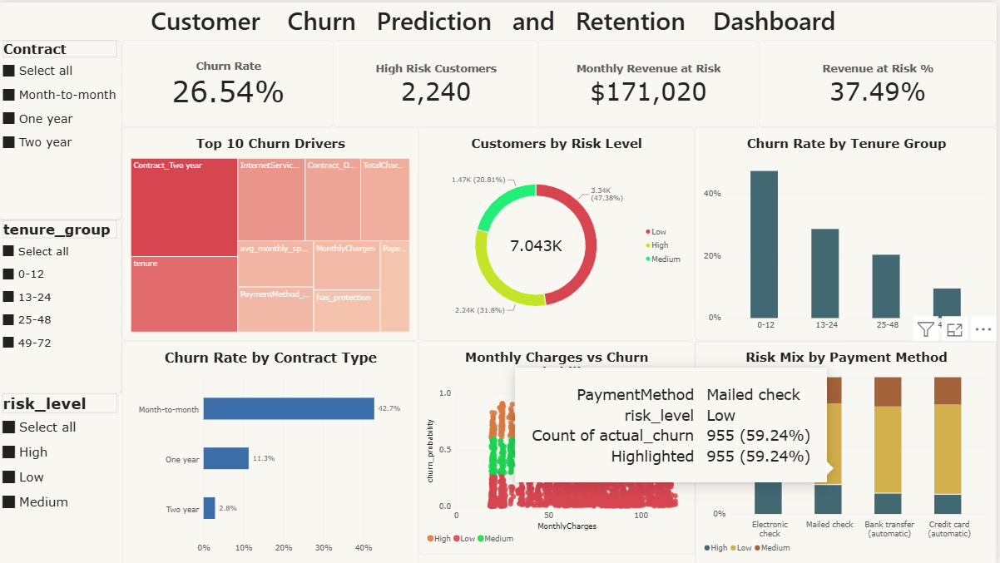

# Customer Churn Prediction and Retention Recommendation System

An end-to-end data science project that predicts which telecom customers are likely to leave, explains why, recommends retention actions, and presents the results in a Power BI dashboard.

## Business problem
Keeping an existing customer costs less than acquiring a new one. This project identifies customers at risk of churning, shows what drives that risk, and suggests what a retention team should do for each one.

## Tech stack
Python (pandas, scikit-learn, XGBoost, SHAP), MySQL, SQL, Power BI, Jupyter Notebook

## Dataset
IBM Telco Customer Churn (Kaggle): 7,043 customers, 21 columns, 26.5% churn rate.
Download: https://www.kaggle.com/datasets/blastchar/telco-customer-churn
Place the CSV in the `data/` folder (the dataset is not included in this repository).

## Workflow
1. **Data loading:** loaded the CSV into MySQL (`customers_raw`).
2. **Cleaning:** `TotalCharges` was stored as text and had 11 blank values, all for brand-new customers with tenure 0, so they were set to 0. Converted `Churn` to 1/0 and merged "No internet service" and "No phone service" into "No".
3. **Exploratory analysis:** SQL queries and charts on churn by contract, payment method, tenure and internet service.
4. **Feature engineering:** number of services, auto-pay flag, protection services, average monthly spend, tenure groups, and one-hot encoding.
5. **Modeling:** logistic regression baseline and XGBoost on an 80/20 stratified split.
6. **Explainability:** SHAP values for global drivers and per-customer explanations.
7. **Risk scoring:** each customer is scored Low, Medium or High risk from the predicted churn probability.
8. **Retention recommendations:** rules map each at-risk customer's profile to a specific action and offer.
9. **Dashboard:** Power BI report built on the MySQL tables.

## Model performance (test set, 1,409 customers)
| Model | ROC-AUC |
|---|---|
| Logistic regression (baseline) | 0.842 |
| XGBoost | 0.841 |

XGBoost churn results: recall 78% (293 of 374 churners identified), precision 52%, F1 0.62.

- Class weighting was used to favor recall, because missing a churner costs more than a retention offer sent to a customer who would have stayed.
- A simple logistic regression matched XGBoost, so the extra complexity added little predictive power on this dataset. XGBoost was kept because it works well with SHAP and leaves room for tuning.

## Key findings
- Month-to-month customers churn at **42.7%**, against 11.3% for one-year and 2.8% for two-year contracts.
- Churn is highest in the first 12 months of tenure and falls steadily with tenure.
- Customers paying by electronic check have the largest share of high-risk customers.
- The strongest churn drivers (SHAP) include contract type, tenure and fiber optic internet service.

## Business impact
- **2,240 customers (31.8%)** are flagged as high risk.
- They account for **$171,020 of monthly revenue**, which is **37.5%** of the total.
- Assuming a retention campaign saved 20% of these customers, about **$34,000 per month** would be protected. This figure is an illustrative assumption, not a measured result.

## Dashboard



## Project structure
```
data/          raw dataset (not uploaded)
notebooks/     01 load, 02 cleaning and EDA, 03 features, 04 model,
               05 SHAP, 06 risk scoring, 07 recommendations
sql/           analysis queries
powerbi/       dashboard file and screenshots
models/        saved models
requirements.txt
```

## How to run
1. Install MySQL and create a database called `churn_db`.
2. Create a `.env` file in the project root:
   ```
   MYSQL_USER=root
   MYSQL_PASSWORD=your_password
   MYSQL_HOST=localhost
   MYSQL_DB=churn_db
   ```
3. Create a virtual environment and run `pip install -r requirements.txt`.
4. Download the dataset into `data/` and run the notebooks in order (01 to 07).
5. Open `powerbi/churn_dashboard.pbix` and refresh the data.

## Limitations and next steps
- Recommendations are rule-based and informed by SHAP drivers. A next step is generating them with an LLM.
- The model was evaluated on a single train/test split. Cross-validation and threshold tuning are future work.
- Risk thresholds (0.30 and 0.60) were chosen for simplicity and not optimized for cost.
- Probabilities for risk scoring were computed on the full dataset, including customers the model was trained on, so they look slightly better than they would on new customers.


## Data

This project uses the Telco Customer Churn dataset from Kaggle: https://www.kaggle.com/datasets/blastchar/telco-customer-churn

The CSV is not included in this repository. Download it and place it in a `data/` folder to run the notebooks.


